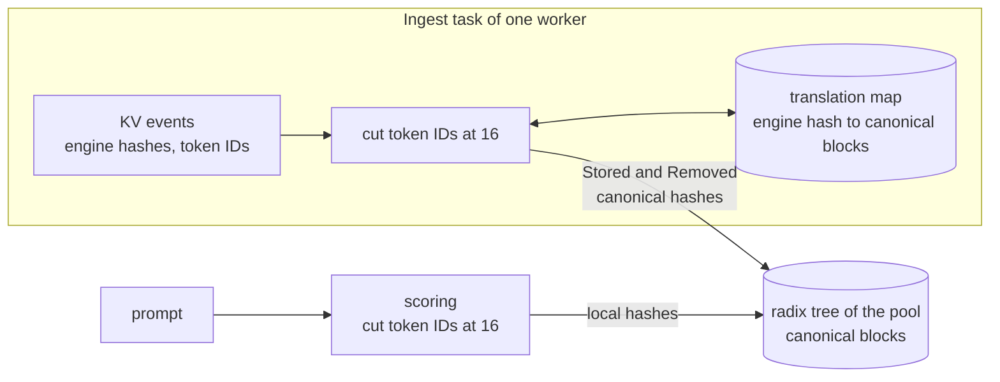
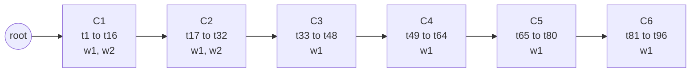

# Index KV events at one canonical block size

## Summary

Kinference stops asking the operator for a block size, because the
operator often can't know the right value and a wrong value evicts
every worker of the set. Ingest and scoring cut token IDs into blocks
of 16 tokens, and ingest indexes every `BlockStored` event whose block
size is a multiple of 16. No KV event takes a worker out of service,
and ingest counts each event that it skips with a reason.

## Why

An operator has to set `kvBlockSize` on every `InferenceWorkerSet`,
and often can't know the right value. vLLM derives the published block
size in several steps. One worker publishes one size for each KV cache
group. The workers of one worker set can differ during a rollout.

A wrong value evicts every worker of the set. Ingest also drops events
without a signal, so the operator can't tell why the router predicts
no reuse for a worker.

## Today

- The CRD and the static config require a block size. The controller
  rejects a worker set with `MissingKvBlockSize` or
  `InvalidKvBlockSize`.
- dynamo's normalizer indexes nothing from an event whose size differs
  from `kvBlockSize`.
- `BlockSizeGuard` in `crates/kinference-fleet/src/ingest.rs` evicts a
  worker after three consecutive events at the same mismatching size.
- Scoring hashes the prompt at the block size of each pool that it
  scores, in `crates/kinference-router/src/service/scoring.rs`.
- `KvIndexer::apply_event` returns nothing, so ingest can't tell when
  the radix tree skips an event.

The only workaround is trial and error with `kvBlockSize`. A worker
set whose workers publish different sizes has no workaround.

## Proposal

### One canonical block size

`kinference-fleet` owns one constant, the canonical block size. Its
value is 16, and no setting changes it. Ingest, scoring and the
in-flight prefixes read the constant.

Ingest indexes an engine block whose size is a multiple of 16, up to
1024 tokens. Such an engine block is a whole number of canonical
blocks. Ingest skips an event at any other block size and counts the
skip.

### Components and data structures



Three hashes name a block.

- The engine hash comes from vLLM in a KV event. It covers the prefix
  up to the end of one engine block. Kinference can't compute it.
- The local hash is XXH3 over the 16 token IDs of one canonical block.
  Ingest and scoring both compute it, and a lookup follows it.
- The canonical hash is new. Ingest computes it with dynamo's
  `compute_next_seq_hash`. It covers the prefix up to the end of one
  canonical block, and it is equal on every worker. The canonical
  hash of a prefix's first block equals that block's local hash, as in
  dynamo's `compute_seq_hash_for_block`.

The radix tree of a pool keeps its structure. A node becomes one
canonical block instead of one engine block. A node stores its
workers, its children by local hash, and the canonical hash in place
of the engine hash.

The translation map is new. Each worker's ingest task owns one map for
each data-parallel rank. An entry lists the canonical blocks of one
engine block and counts the stores of that engine block. The count is
1 in every example below, so the examples leave it out. The map exists
because a KV event names blocks by engine hash, and the radix tree
knows canonical hashes only.

```yaml
H1: [C1, C2]    # key: engine hash with its group and medium
```

One worker's first 96 tokens, stored as three 32-token engine blocks.
One character is one token.

```text
token IDs         t1              t17             t33             t49             t65             t81
                  |               |               |               |               |               |
engine blocks     [========= H1: t1-32 ==========][========= H2: t33-64 =========][========= H3: t65-96 =========]
canonical blocks  [===== C1 =====][===== C2 =====][===== C3 =====][===== C4 =====][===== C5 =====][===== C6 =====]
```

### When a `BlockStored` event arrives

Worker `w1` publishes 32-token engine blocks in two events. One event
has one `block_size`, and `token_ids` is one flat list for all of the
event's engine blocks.

```yaml
- type: BlockStored
  block_hashes: [H1, H2]
  parent_block_hash: null
  token_ids: [t1..t64]
  block_size: 32
- type: BlockStored
  block_hashes: [H3]
  parent_block_hash: H2
  token_ids: [t65..t96]
  block_size: 32
```

For each event, ingest takes four steps. A skip in steps 1 to 3 leaves
the map and the radix tree unchanged.

1. When `block_size` is zero, isn't a multiple of 16 or is above
   1024, ingest skips the event.
2. When the event has a parent, ingest finds the parent's entry in the
   map. When the map has no such entry, ingest skips the event. An
   event without a parent starts at the root.
3. Ingest splits `token_ids` into one run of `block_size` tokens for
   each engine hash. When the token IDs don't split that way, ingest
   skips the event. vLLM's `cache_full_blocks` sends such events.
4. Ingest cuts each run into canonical blocks and writes one entry for
   each engine block that the map doesn't have yet. Ingest sends the
   radix tree one `Stored` event with every canonical block of the
   event, in order. The parent is the last canonical block of the
   parent's entry. The radix tree changes nothing for a canonical
   block that the worker already holds.

```yaml
# After the first event: t1..t32 for H1, t33..t64 for H2
translation map of w1:
  H1: [C1, C2]
  H2: [C3, C4]
radix tree:
  root -> C1 {w1} -> C2 {w1} -> C3 {w1} -> C4 {w1}

# After the second event: Stored for C5 and C6, with the parent C4
translation map of w1:
  H1: [C1, C2]
  H2: [C3, C4]
  H3: [C5, C6]
radix tree:
  root -> C1 {w1} -> C2 {w1} -> C3 {w1} -> C4 {w1} -> C5 {w1} -> C6 {w1}
```

Worker `w2` publishes 16-token engine blocks and stores the first 32
of the same tokens.

```yaml
- type: BlockStored
  block_hashes: [G1, G2]
  parent_block_hash: null
  token_ids: [t1..t32]
  block_size: 16
```

```yaml
# After the event of w2: t1..t16 for G1, t17..t32 for G2
translation map of w2:
  G1: [C1]
  G2: [C2]
radix tree:
  root -> C1 {w1, w2} -> C2 {w1, w2} -> C3 {w1} -> C4 {w1} -> C5 {w1} -> C6 {w1}
```

`w2` reaches the same two nodes as `w1`, although the two workers use
different block sizes.



A worker that publishes 24-token engine blocks fails step 1 on every
event. The radix tree holds no blocks for that worker, and the worker
stays in service. The same holds for a partial entry of vLLM whose
block size is smaller than 16.

A holder is one engine hash at one group and one `medium`. Two KV
cache groups can publish the same engine hash, and one block can be on
two mediums. Each holder has its own entry. When a `BlockStored` event
names a holder that the map already has, ingest raises the entry's
store count and writes no second entry. vLLM's chunk-mode offloading
sends such events.

An event of an older vLLM release names no group. Two groups of such a
worker share one holder, and ingest can't tell their blocks apart.

### When a `BlockRemoved` event arrives

```yaml
- type: BlockRemoved    # from w1
  block_hashes: [H3]
```

Ingest takes four steps for each engine hash of the event. An engine
hash that the map doesn't have doesn't stop the removal of the event's
other engine hashes.

1. Ingest finds the entry of H3. When the map has no such entry,
   ingest counts the event as skipped and goes to the next engine
   hash.
2. Ingest lowers the entry's store count. When the count is still
   above zero, ingest stops here.
3. Ingest sends the radix tree a `Removed` event for each canonical
   block of the entry that no other entry of the worker lists. Ingest
   keeps one count for each canonical block of the worker for this
   check.
4. Ingest deletes the entry.

```yaml
# After the removal: Removed for C5 and C6
translation map of w1:
  H1: [C1, C2]
  H2: [C3, C4]
radix tree:
  root -> C1 {w1, w2} -> C2 {w1, w2} -> C3 {w1} -> C4 {w1}
```

A `BlockRemoved` event of an older vLLM release names no group. Ingest
then deletes every entry of that engine hash at the event's `medium`.

On `AllBlocksCleared`, ingest empties the maps of every data-parallel
rank of the worker, because the radix tree clears every rank. The maps
also empty when the worker leaves the pool. The ingest task keeps the
map when the listener reconnects. The ingest task owns the map, so the
map needs no lock.

### When the router looks up a prompt

A prompt of 54 tokens arrives after the removal. L1 to L4 are the
local hashes of C1 to C4.

```yaml
prompt:
  token_ids: [t1..t48, x1..x6]
radix tree:
  root -L1-> C1 {w1, w2} -L2-> C2 {w1, w2} -L3-> C3 {w1} -L4-> C4 {w1}
```

1. The router tokenizes the prompt, as today.
2. Scoring cuts the token IDs into runs of 16 tokens, drops a shorter
   last run, and computes one local hash for each run.
3. Scoring walks the radix tree once from the root, by local hash. A
   worker that is missing from a node stops matching there.
4. The router turns each worker's matched canonical blocks into
   predicted cached tokens.

```yaml
# Step 2
runs:
  - [t1..t16]    # local hash L1
  - [t17..t32]   # local hash L2
  - [t33..t48]   # local hash L3
dropped: [x1..x6]

# Step 3
- follow L1 to C1: workers {w1, w2}, still matching: [w1, w2]
- follow L2 to C2: workers {w1, w2}, still matching: [w1, w2]
- follow L3 to C3: workers {w1},     still matching: [w1]

# Step 4
w1: {matched: [C1, C2, C3], predicted_cached_tokens: 48}
w2: {matched: [C1, C2],     predicted_cached_tokens: 32}
```

The engine of `w1` reuses 32 of those tokens, not 48, because the
prompt doesn't hold all of H2. This gap is the first case under Known
error.

Scoring hashes the prompt at one size for every pool. The in-flight
prefixes hold local hashes at the canonical size. The predictor's two
attention coefficients keep their names, and their unit becomes one
block of 16 tokens.

### Events that ingest skips

A new module in `kinference-fleet` replaces dynamo's conversion from a
raw event to a router event. Ingest keeps dynamo's decoder and group
filter. The module does no I/O. Ingest increments
`kinference_index_events_skipped_total{workerset, reason}` once for
each skipped event. The `decode` reason counts frames, because ingest
can't tell how many events a rejected frame held.

- `decode`: dynamo's decoder rejects the frame. An event without a
  `block_size` field fails here.
- `group_not_indexed`: the event's group isn't a main attention group.
- `lora`, `multimodal`, `bigram`: the event has an adapter name,
  multimodal info or token pairs. Such a block matches no prompt
  today.
- `no_token_ids`: a `BlockStored` event has no token IDs, as for an
  offloaded block.
- `block_size_unaligned`: `block_size` is zero or isn't a multiple of
  16.
- `block_size_too_large`: `block_size` is above 1024. An older vLLM
  release publishes Mamba blocks of 1568 tokens without a group.
- `shape`: the token IDs don't split into the blocks, or the event
  names one engine hash twice.
- `parent_unknown`: the map doesn't hold the parent.
- `block_unknown`: a `BlockRemoved` event names a holder that the map
  doesn't have.

After ingest skips a `BlockStored` event, ingest also skips every
later event of the same chain, with the reason `parent_unknown`. The
same happens for a chain that began before the listener connected,
because replay is off by default.

The pull request that moves ingest to the canonical size removes
`BlockSizeGuard` and `EvictionReason::BlockSizeMismatch`. After that
pull request, no code path leads from a KV event to an eviction.

### Predicted and reported reuse

The change adds no metric for this comparison. The router already
exports both sides for each model.

- Predicted: `kinference_prefix_matched_blocks_total` over
  `kinference_prefix_requested_blocks_total`.
- Reported by the engine: `kinference_cached_prompt_tokens_total` over
  `kinference_prompt_tokens_total`. The router reads the cached tokens
  from the final-token report of each request.

Today a block has a different number of tokens in each worker set, so
the operator can't turn matched blocks into tokens. After the change,
one block is 16 tokens for every worker, and the two shares are
directly comparable.

### Known error

The router's predicted reuse can exceed the engine's reuse.

- A prompt shares only part of an engine block with a cached prefix.
  The router credits the shared canonical blocks, and the engine
  reuses none of that engine block. For an engine block of B tokens,
  the error is at most B minus 16 tokens for each request.
- The model is hybrid. The engine reuses a prefix only as far as every
  group can serve the prefix, and ingest indexes the main attention
  groups only.
- Ingest missed a `BlockRemoved` event, or the engine restarted under
  the same worker ID. The map and the radix tree then hold blocks that
  the engine no longer has. The radix tree has the same error today.

No counter counts an overstatement. For each model, the gap between
the predicted share and the reported share shows the size of the
error.

The radix tree holds no blocks for a worker whose block size isn't a
multiple of 16. The `block_size_unaligned` reason of the skip
counter shows that case, and `kinference_index_workers` stays below
the number of workers.

### Out of scope

- Indexing Mamba, sliding-window or other groups.
- Indexing engine blocks whose size isn't a multiple of 16.
- A recorder for a live worker's raw events.
- A backoff when the listener reconnects after an eviction.
- An upgrade of the `dynamo-kv-router` pin.

### Invariants

- Import direction: the constant and the new module live in the fleet,
  and the router already imports the fleet.
- The fleet: pools still share no radix trees.
- The picker stays pure. Its inputs lose `block_size`.
- Who writes: `commit` still inserts into the in-flight prefixes under
  the pick lock, and ingest's `on_stored` still removes from them.
- The CRD schema: `InferenceWorkerSet` loses a required field. The
  picker protocol and the `BackendBinding` name no block size.
- ARCHITECTURE.md: the Vocabulary entries for "Worker set" and "Block"
  change with the first pull request.

## Alternatives considered

**Learn each worker's block sizes from its events.** Scoring hashes
the prompt once per size on every request, and the learned sizes are
wrong after a worker restarts. Two groups of one worker also publish
the same engine hash at different sizes, and the radix tree finds a
node by engine hash alone.

**Pass a leftover between engine blocks.** For each engine block,
ingest would keep the tokens after the last complete canonical block,
and the next engine block of the chain would continue from them. Ingest
could then index any block size. The proposal leaves the leftover out
because Kinference has no reliable way yet to test that the leftover
is correct. Such a test compares the index with the cache of a live
engine that publishes an unaligned block size, and Kinference has no
recorder for a live worker's raw events. The leftover also puts token
IDs into the translation map, needs a memory bound for small engine
blocks, and adds an error case when the engine removes a block from
the middle of a chain. vLLM's default sizes are 16 and 64, and neither
size needs a leftover. The `block_size_unaligned` count shows when a
deployment needs the leftover. llm-d deferred the same mechanism.

**Index an unaligned event anyway.** llm-d indexes such an event. When
an event's tokens don't end on a canonical boundary, the next event of
the chain keys its blocks at the wrong offset, and nothing reports the
wrong offset.

**Index the start of an unaligned chain.** Ingest would index an
unaligned event that starts on a canonical boundary, keep the event's
complete canonical blocks, and drop the remaining tokens. Ingest would
skip every later event of the chain with the reason `parent_unknown`.
A worker with a block size of 1 whose first event has 100 tokens would
then get 96 tokens indexed. llm-d indexes the same blocks, so this
design indexes less than llm-d for an unaligned worker. The proposal
leaves this alternative out, because nobody has reported a deployment
with unaligned workers. When the `block_size_unaligned` count shows
such a deployment, the leftover covers the whole chain, and this
alternative covers only the start of the chain.

**Make the canonical size a setting.** With a setting, the operator has
to choose a block size again.

## Prior art

All sources read on 2026-11-13.

**llm-d**, `llm-d/llm-d-router` at `647ca7c`, `pkg/kvevents/pool.go`
and `pkg/kvcache/kvblock/`. llm-d re-chunks each event at a configured
size, default 16, and maps engine hashes to its own keys. llm-d counts
stores per pod, tier, group and hash, and counts most skips by reason.
No event stops routing to a pod. Kinference adopts each of these
behaviours. llm-d has one defect
that Kinference avoids. llm-d indexes an event whose blocks don't end
on a canonical boundary, and keys the next event's blocks at the wrong
offset. Kinference skips such an event and counts the skip. Pull
request
<https://github.com/llm-d/llm-d-router/pull/3323> passed tokens from
one event to the next. Nobody reviewed the pull request, and its
author closed it as deferred until a deployment needs the mechanism.
Issue
<https://github.com/llm-d/llm-d-router/issues/2889> reports the first
Known error.

**AIBrix**, `vllm-project/aibrix` at `2564614`. AIBrix learns one
block size per model from the events, since
<https://github.com/vllm-project/aibrix/pull/3072>. That pull request
says that a hybrid model with different group sizes "can still miss
some blocks".

**NVIDIA Dynamo**, `ai-dynamo/dynamo` at the pinned `12207ba` and at
`main` `8f08a79`. The normalizer in `zmq_wire/convert.rs` requires one
block size at both revisions. The radix tree in
`indexer/radix_tree.rs` reads no block size and accepts hand-built
events through public types. dynamo's approximate mode builds its
sequence hashes with `compute_next_seq_hash`, through
`compute_seq_hash_for_block` in `protocols.rs`.
Upstream's proposal for several sizes assumes that the small size
divides the large one,
<https://github.com/ai-dynamo/dynamo/issues/14944>.

**vLLM**, `vllm-project/vllm` at `4dd68d1`, `vllm/v1/core/`. A
`BlockStored` event states its group's block size, and the event's
hash leaves out the group. `cache_full_blocks` leaves null and masked
blocks out of `block_hashes` while `token_ids` covers them.
`BlockRemoved` has `group_idx` since v0.20.0. The default block size
is 64 on `main` and 16 up to v0.33.0. The tracker
<https://github.com/vllm-project/vllm/issues/63149> lists the open
defects of the event stream.

## Operator-visible changes

- Removed: `InferenceWorkerSet.spec.kvBlockSize`, the config's
  `kv_block_size`, the status reasons `MissingKvBlockSize` and
  `InvalidKvBlockSize`, and the `block_size_mismatch` value of the
  `reason` label of `kinference_worker_evictions_total`.
- New: `kinference_index_events_skipped_total{workerset, reason}`.
- The radix tree holds no blocks for a worker whose engine block size
  isn't a multiple of 16. Today the operator can set `kvBlockSize` to
  such a size, and `src/config.rs` names 1 as the typical value for
  SGLang with `--page-size 1`. After the change, no setting restores
  the prediction for that worker.
- A block is 16 tokens in every number that counts blocks: the
  predictor's two attention coefficients, the block counters and
  gauges, the observation events and the policy API.
- An operator who fitted a profile at a `kvBlockSize` of B other than
  16 refits the profile. As a start, the operator multiplies
  `attention_uncached_block_ms` by 16/B and
  `attention_uncached_per_every_block_ms` by the square of 16/B.
- The default values of the two coefficients don't change. An operator
  who runs the defaults at a `kvBlockSize` of B other than 16 sees the
  linear term of the predicted prefill time grow by B/16 and the
  quadratic term by the square of B/16.

## Compatibility and rollout

Each replica builds its index in memory, so no state crosses an
upgrade. The gateway needs no upgrade.

The first pull request makes `kvBlockSize` optional in the CRD and
`kv_block_size` optional in the static config, and reads neither. The
same pull request changes the unit of the predictor's coefficients, so
an operator whose `kvBlockSize` isn't 16 rescales the profile in that
upgrade.

The last pull request removes `kvBlockSize` from the CRD. The operator
upgrades the Kinference chart to the first pull request or later
before the CRD chart. With the CRD chart first, the API server prunes
`kvBlockSize`, and an older controller rejects every worker set. The
operator deletes `kvBlockSize` from the manifests once the CRD chart
is upgraded. The config ignores a `kv_block_size` that the operator
leaves in a worker set. A rollback reverses the order and restores the
field in the manifests and the config.

The radix tree holds four times the nodes for a worker that published
64-token blocks. The estimate from the struct sizes is 350 to 400
bytes per node. Nobody has measured a live tree.

## Break-down

- Index KV events at the canonical block size. Done: `kvBlockSize` is
  optional, and no code reads its value. A worker that publishes events
  at several block sizes stays in service, and the router predicts
  reuse from every event whose block size is a multiple of 16.
  `kinference_index_events_skipped_total{workerset, reason}` rises
  once for each event that ingest skips. No KV event raises
  `kinference_worker_evictions_total`. A changed `kvBlockSize` no
  longer replaces the worker set's pool, and the controller accepts a
  worker set that has no block size.
- Remove `kvBlockSize`. Done: the e2e manifests, the CRD and the
  static config have no block size field, and the controller has no
  `MissingKvBlockSize` or `InvalidKvBlockSize` reason.

## Open questions

What does a canonical size of 16 cost in memory and in lookup time?
The maintainers decide from measurements in the first pull request.

Does a counted skip satisfy the third requirement of issue 86? The
author of issue 86 decides in the review of this design.

How often does vLLM send a `BlockStored` event for a main attention
group whose token IDs don't split into the event's blocks? Ingest
skips such an event and every later event of the same chain. The
author of the first pull request measures the `shape` count against a
live vLLM, and the maintainers decide in that pull request whether
ingest indexes the blocks before the gap.
