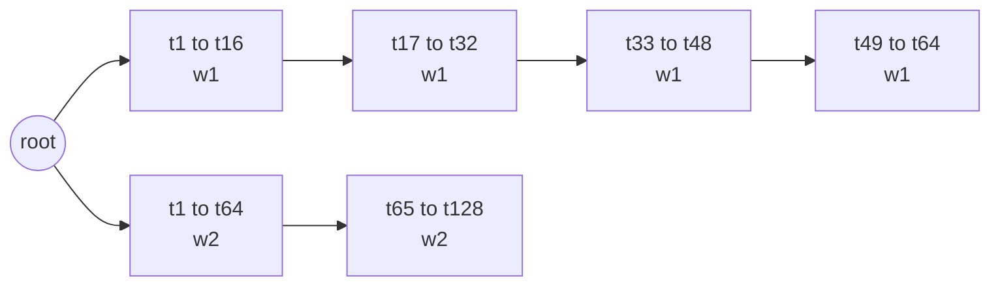

# Index each worker at the block size of its KV events

## Summary

Kinference stops asking the operator for a block size. Ingest learns
each worker's block size from the worker's KV events and indexes one
KV cache group per worker at that block size. The radix tree of a pool
already holds workers with different block sizes, so the workers of
one worker set no longer have to agree on a size.

## Why

An operator has to set `kvBlockSize` on every `InferenceWorkerSet`,
and often can't know the right value. vLLM can change the block size
that the operator passed. The workers of one worker set can publish
different sizes during a rollout, and then no value is right.

With a wrong value, ingest skips every `BlockStored` event of the
worker set, and the router predicts no reuse for its workers.

## Today

- The CRD and the static config require a block size. The controller
  rejects a worker set with `MissingKvBlockSize` or
  `InvalidKvBlockSize`.
- Ingest skips a `BlockStored` event whose block size differs from
  `kvBlockSize`, in `crates/kinference-fleet/src/ingest.rs`.
  `kinference_kv_events_skipped_total` counts the event under
  `block_size_mismatch`.
- Ingest applies every `BlockRemoved` event of a main attention group.
  vLLM uses the same engine hash for a block in every KV cache group.
  A removal from one group therefore also removes another group's
  block from the radix tree.
- A change of `kvBlockSize` replaces the worker set's pool and empties
  its radix tree, in `crates/kinference-fleet/src/pool.rs`.
- Scoring hashes the prompt once for each block size among the
  candidate workers, in
  `crates/kinference-router/src/service/scoring.rs`. Today one pool
  has one block size.
- The picker computes prefill time from block counts and two per-block
  coefficients, in `crates/kinference-router/src/picker.rs`.

The only workaround is trial and error with `kvBlockSize`.

## Proposal

### Learn the block size from the events

Every `BlockStored` event states the block size of its blocks. vLLM
fills the field with the group's actual block size, and the field is
required. Ingest reads the field today, but only to compare it with
`kvBlockSize`.

```yaml
- type: BlockStored
  block_hashes: [H1, H2]
  token_ids: [t1..t32]
  block_size: 16
  group_idx: 0
  kv_cache_spec_kind: full_attention
```

Ingest takes a worker's block size from the worker's first
`BlockStored` event and writes the size to the worker's registry
entry. Ingest cuts the event's token IDs at that size. Scoring cuts
the prompt at the same size for that worker, so a lookup finds the
blocks that ingest stored. Until the first event arrives, the router
picks the worker on load alone.

A later event of the same worker can state another size.

- A smaller size is a partial entry. vLLM publishes one when a prompt
  ends inside a block. Ingest skips the event.
- A larger size replaces the worker's block size. Ingest first clears
  the worker's blocks from the radix tree.

Ingest still skips an event whose block size is zero or above 1024.

### One radix tree for several block sizes

dynamo's radix tree knows no block size. A node keys its children by
local hash, and the local hash covers the token IDs of one block.
Blocks of different sizes get different local hashes, so each block
size forms its own branch from the root.

Worker `w1` publishes 16-token blocks and holds the first 64 tokens of
a prompt. Worker `w2` publishes 64-token blocks and holds the first
128 tokens of the same prompt. Both workers are in one worker set.



A lookup at 16 tokens finds `w1`, and a lookup at 64 tokens finds
`w2`. Scoring already hashes the prompt once for each block size among
the candidate workers, so scoring doesn't change. The picker and the
predictor's coefficients don't change either.

The policy reads `inputTokens` before the picker picks a worker, so
`inputTokens` can't depend on a worker's block size. The router sets
`inputTokens` to the prompt's token count, which scoring already has.
Today the router multiplies the prompt's block count by the pool's
block size.

### One group per worker

A worker can have more than one main attention group, and each group
has its own block size. One example is speculative decoding. A small
draft model proposes tokens, the main model checks them, and vLLM
keeps a separate KV cache group for the draft model.

Ingest indexes one group per worker and skips the `BlockStored` and
`BlockRemoved` events of every other group.

Ingest selects the group and the block size in this order.

1. A group is a candidate when its kind is `full_attention`,
   `mla_attention` or `sink_full_attention`, and the worker has sent a
   `BlockStored` event for it.
2. The indexed group is the candidate with the lowest `group_idx`.
3. The worker's block size is the largest block size that a
   `BlockStored` event of the indexed group has stated.

The selection changes in two cases only. In both cases, ingest first
clears the worker's blocks from the radix tree.

- A candidate with a lower `group_idx` sends its first `BlockStored`
  event. That group becomes the indexed group, and the event's block
  size becomes the worker's block size.
- The indexed group states a larger block size. The larger size
  becomes the worker's block size.

dynamo's vLLM worker makes the same choice with other means. The
worker runs next to the engine and asks the engine for its list of
groups at startup. It takes the block size of the first main attention
group in that list, and vLLM lists the groups by `group_idx`. Kinference
has no component next to the engine, so ingest reaches the same group
from the events.

Ingest can't index both groups in one radix tree. vLLM names the
blocks of every group from one chain of engine hashes, and the radix
tree finds a worker's block by engine hash alone. A removal from one
group would remove the other group's block. `main` has this defect
today.

An older vLLM release names no group in its events. Ingest treats
such a worker as a worker with one group.

### Skipped events

`kinference_kv_events_skipped_total{workerset, reason}` counts each
skipped event. Two reasons change.

- `unindexed_attention_group` is new. The event belongs to a main
  attention group that ingest doesn't index.
- `block_size_mismatch` now means that the event's block size is
  smaller than the worker's block size.

### Limits

- The predictor's coefficients are per block. In a worker set that
  mixes block sizes, the picker predicts a shorter prefill time for
  the worker with the larger blocks. A worker set mixes block sizes
  during a rolling upgrade of its engines.
- The engine reuses a prefix only when every group holds the prefix.
  The router predicts too much reuse when a group that ingest doesn't
  index evicts first.
- An engine can restart with a smaller block size under the same
  worker ID.
- Mamba and sliding-window groups stay unindexed, as today.

### Follow-up work

Two pieces of work need their own issues.

The first is prefill time in tokens, which issue 249 delivers. With
coefficients per token, one profile gives comparable prefill times to
workers with different block sizes. The change renames the predictor's
two coefficients, so every operator with a fitted profile has to
convert the profile.

The second is more than one group per worker. That design has to say
how the radix tree keeps two groups of one worker apart, and how
scoring combines their matches. This proposal leaves room for it.
Ingest records every group that a worker sends, no CRD or config field
promises one block size per worker, and the
`unindexed_attention_group` count shows how many events are waiting.

### Invariants

- Import direction: the new state lives in the fleet, and the router
  already imports the fleet.
- The fleet: pools still share no radix trees.
- The picker stays pure, and its inputs don't change.
- Who writes: ingest writes the worker's block size to the registry
  entry, as ingest already writes `kv_events_observed`.
- The CRD schema: `InferenceWorkerSet` loses a required field. The
  picker protocol and the `BackendBinding` name no block size.
- ARCHITECTURE.md: the Vocabulary entries for "Worker set" and "Block"
  change with the first pull request.

## Alternatives considered

**Cut every event into blocks of one canonical size.** An earlier
draft of this design proposed this alternative. Ingest and scoring
would cut token IDs into blocks of 16 tokens. Workers of different
sizes would share nodes, and scoring would do one lookup for each
request. The alternative has four costs.

- Ingest needs a map from engine hash to canonical blocks for each
  worker.
- The router credits a worker for part of an engine block, and the
  engine can't reuse part of a block.
- A worker whose block size isn't a multiple of 16 gets no prediction.
- The radix tree holds four times the nodes for a worker with
  64-token blocks.

The proposal costs one extra hash pass and one extra lookup for each
request when a pool has two block sizes.

**Index every main attention group now.** The router's prediction
would then cover every group of a worker. The radix tree finds a
worker's block by engine hash alone, so ingest would first need a way
to keep two groups of one worker apart in the tree. Scoring would also
need a rule that combines the matches of two groups into one
prediction. Neither question has an answer yet, and both need research
against a live engine. The proposal defers this work to keep the first
change small. The `unindexed_attention_group` count shows how many
events the deferred work would index.

**Read the block size from the engine's metrics.** dynamo's vLLM
worker reads the size from the engine's config. Kinference could
scrape `vllm:cache_config_info` for the same value. The CRD's
documentation says that Gemma 4 reports 64 there while its events
have 256-token blocks. Ingest indexes the events, so ingest needs the
block size that the events state.

**Take the first group that the worker sends.** With this rule, a
worker's indexed group never changes. The first group depends on which
prompt the worker serves first. Two replicas of Kinference, or two
workers of one model, could then index different groups.

## Prior art

Sources read on 2026-11-13 and 2026-11-17.

**NVIDIA Dynamo**, `ai-dynamo/dynamo` at the pinned `12207ba`. dynamo
selects one block size per worker, at startup. Its vLLM worker runs
next to the engine and calls the engine's
`get_kv_cache_group_metadata` once, in
`components/src/dynamo/vllm/cache_info.py`. vLLM returns the groups in
`group_idx` order. The worker takes the block size of the first main
attention group and falls back to `cache_config.block_size`. The
worker registers that size with the model, and the size never changes.

On the router's side, the normalizer in `zmq_wire/convert.rs` drops a
block of any other size. The normalizer filters events by kind and
never by `group_idx`. A removal from a second main attention group
therefore reaches the radix tree, and so does a stored block of a
second group with the same block size. The radix tree in
`indexer/radix_tree.rs` reads no block size.

Kinference selects the same group from the events, because Kinference
has no component next to the engine. Kinference also skips the events
of every other group. Upstream's proposal for several sizes assumes
that the small size divides the large one,
<https://github.com/ai-dynamo/dynamo/issues/14944>.

**llm-d**, `pkg/kvcache/kvblock/hma.go` and
`pkg/kvcache/prefix_match.go` in a source snapshot without a commit,
and `llm-d/llm-d-router` at `647ca7c`. llm-d re-chunks each event at a
configured size, default 16. A catalog for each pod learns the kind
and the block size of every group. An index entry names its group, and
a removal evicts only the entry of its own group. The scorer counts a
pod as a holder of a block while any group holds the block. No event
stops routing to a pod. Kinference adopts the per-group record and the
counted skips, and leaves the re-chunking out. Pull request
<https://github.com/llm-d/llm-d-router/pull/3323> passed tokens from
one event to the next for unaligned sizes. The pull request's author
closed the pull request as deferred.

**AIBrix**, `vllm-project/aibrix` at `2564614`. AIBrix learns one
block size per model from the events, since
<https://github.com/vllm-project/aibrix/pull/3072>. That pull request
says that a hybrid model with different group sizes "can still miss
some blocks". Kinference learns the size per worker instead, so the
workers of one model can differ.

**vLLM**, `vllm-project/vllm` at `0ef2a95`, `vllm/v1/core/`. A
`BlockStored` event states its group's index, kind and block size.
`BlockHashListWithBlockSize` in `kv_cache_utils.py` gives a group with
larger blocks every Nth hash of the request's chain. `block_pool.py`
publishes a `BlockRemoved` event with the group's index and the hash
without the group. `FullAttentionManager` in
`single_type_kv_cache_manager.py` stores a partial entry when its
block size is larger than the block size of the hash chain, and
`cache_partial_block` publishes the entry with the manager's own group
index. By default, every layer uses `CacheConfig.block_size`. A draft
model, an EAGLE head and hidden-state extraction add a main attention
group with its own block size. `unify_kv_cache_spec_page_size` in
`kv_cache_planning.py` raises the block size of layers with a smaller
page. The tracker
<https://github.com/vllm-project/vllm/issues/63149> lists the open
defects of the event stream.

## Operator-visible changes

- Removed: `InferenceWorkerSet.spec.kvBlockSize`, the config's
  `kv_block_size`, and the status reasons `MissingKvBlockSize` and
  `InvalidKvBlockSize`.
- A worker set may hold workers with different block sizes. The
  router predicts reuse for each worker at the worker's own size. The
  predicted prefill times of workers with different block sizes aren't
  comparable.
- The predictor's coefficients keep their names and their unit. A
  block is as long as the worker's block size.
- New: the `unindexed_attention_group` value of the `reason` label of
  `kinference_kv_events_skipped_total`. The `block_size_mismatch`
  value now counts the events of a worker's indexed group at a smaller
  block size, such as a partial entry.
- `inputTokens` is the prompt's token count. Today the router rounds
  the count down to a multiple of `kvBlockSize`.
- Kinference logs one INFO line when it learns or changes a worker's
  indexed group.
- The policy API replaces a destination's `blockSize` with
  `indexedGroups`, a list with the kind, the block size and the number
  of workers for each distinct group.
- The block counters and gauges keep their names. A block in
  `kinference_prefix_matched_blocks_total` has the size of the worker
  that the router picked.

## Compatibility and rollout

Each replica builds its index in memory, so no state crosses an
upgrade. The gateway needs no upgrade.

The first pull request makes `kvBlockSize` optional in the CRD and
`kv_block_size` optional in the static config. Kinference reads
neither field. An existing profile keeps working without a change.

The last pull request removes `kvBlockSize` from the CRD. The operator
upgrades the Kinference chart to the first pull request or later
before the CRD chart. With the CRD chart first, the API server prunes
`kvBlockSize`, and an older controller rejects every worker set. The
operator deletes `kvBlockSize` from the manifests once the CRD chart
is upgraded. The config ignores a `kv_block_size` that the operator
leaves in a worker set. A rollback reverses the order and restores the
field in the manifests and the config.

During a rolling upgrade of the engines to another block size, old and
new workers are in the pool together. The router predicts reuse for
each worker at the worker's own size.

## Break-down

- Learn each worker's block size from its KV events. Done:
  `kvBlockSize` is optional, and ingest doesn't read its value. The
  controller accepts a worker set that has no block size. The router
  predicts reuse for two workers of one worker set that publish
  different block sizes. A removal from a second main attention group
  leaves the predicted reuse unchanged, and
  `kinference_kv_events_skipped_total` counts the removal under
  `unindexed_attention_group`. A changed `kvBlockSize` no longer
  replaces the worker set's pool. The policy API reports
  `indexedGroups` for each destination.
- Remove `kvBlockSize`. Done: the e2e manifests, the CRD and the
  static config have no block size field, and the controller has no
  `MissingKvBlockSize` or `InvalidKvBlockSize` reason.

## Open questions

What does a live vLLM with two main attention groups send? The design
reads the group layout from vLLM's source and tests, and nobody has
recorded such a worker's events. The author of the first pull request records
those events, and the maintainers decide in that pull request whether
the lowest group index is the right rule.

At which block size does the policy API count a request's
`matchedBlocks` for a destination whose workers have several block
sizes? Today the policy API uses the worker set's block size. The
maintainers decide in the review of the first pull request.

Does a counted skip satisfy the third requirement of issue 86? The
author of issue 86 decides in the review of this design.
