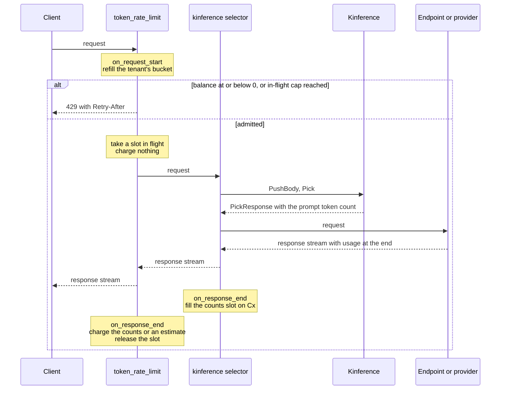

# Limit the tokens that each tenant consumes in the gateway

## Summary

The gateway will gain a `token_rate_limit` extension that keeps one token
bucket per tenant. The extension rejects a tenant's request with 429 while the
tenant's balance is spent. When a response ends, the extension charges the
token counts that the response reports, or an estimate when the response
reports none. An operator can then stop one tenant from taking a shared pool's
capacity without rejecting all of that tenant's traffic. The first pull request
makes the gateway run a route's own filters ahead of the kinference selector,
so that a rejected request never reaches Kinference.

## Why

An operator who shares workers among several tenants wants to cap the
number of tokens that each tenant consumes over time. Today one tenant
that sends long prompts or asks for long completions can take most of
a pool's capacity. The other tenants then wait longer for their first
token. The operator has no way to stop that tenant short of rejecting
all of its traffic.

The operator wants to stop abuse, not to bill exactly. A limit that
each gateway replica enforces on its own is therefore good enough.

The limit should act before a request reaches Kinference. A request
that has no chance of running should not cost Kinference a body
stream and a pick.

## Today

In Kinference:

- The README lists rate limiting under known limitations, in
  `README.md`.
- An `InferencePolicy` rule can match on `inputTokens`, `maxTokens`
  and `tenant`, and a rule can reject a request. A rule judges each
  request on its own and keeps no count across requests.
- Kinference sets `stream_options.include_usage` on every streaming
  chat-completion body that it hands back through `PullBody`, in
  `crates/kinference-router/src/pick_body.rs`. A streamed response
  from vLLM therefore ends with a usage chunk, unless the stream stops
  early.
- `PickResponse` holds no prompt token count. Kinference counts the
  prompt's tokens while it scores local pools. When tokenization
  fails, the count that the policy sees is 0 instead of absent, in
  `crates/kinference-router/src/service/lifecycle.rs` and
  `service/scoring.rs`.
- The gateway reports `prompt_tokens`, `completion_tokens` and
  `cached_tokens` in `ReportFinalToken`. Kinference adds the counts to
  `kinference_prompt_tokens_total` and
  `kinference_completion_tokens_total` and counts them against no
  budget.

In the gateway, `BuoyantIO/gateway` at `f7f4304`:

- The gateway has no rate-limit filter.
- The kinference selector reads the tenant from the request header
  that its `tenantHeader` setting names. In `on_request_start`, the
  selector opens the `PushBody` stream to Kinference, in
  `crates/gateway-extension-impls/src/kinference.rs`. The selector
  parses `usage` from the response with a bounded capture, in
  `kinference/usage.rs`.
- A route that names an `InferencePool` resolves through the
  `BackendBinding` that Kinference's controller writes. The translator
  puts the binding's extensions ahead of the rule's own filters, in
  `crates/gateway-cp/src/translator.rs`. The selector's request hooks
  therefore run before any filter that the route declares.
- An `ExtensionClass` lives as long as the process. The runtime calls
  `ExtensionClass::configure` again for every new revision of a
  route, in `crates/gateway-runtime/src/proxy/extensions.rs`. A route
  gets a new revision whenever a backend that the route names changes,
  and a backend's endpoints count as part of the backend.
  `configure` receives the object's config and not the object's
  namespace and name. The runtime never removes the cache entry of a
  deleted route.
- `Cx` is the per-request context. It holds only what the host fills
  in, in `crates/gateway-extension/src/cx.rs`. Two extensions on one
  route have no way to pass data to each other.
- The control plane sets each Gateway's data-plane replica count from
  the `gateway.buoyant.io/dp-replicas` annotation, with a default of
  1, in `crates/gateway-cp/src/infra/annotations.rs`. The data plane
  never learns that count.

No workaround exists in either project.

## Proposal

The limiter lives in the gateway. Kinference adds one field to
`PickResponse` and documents the limiter.

The diagram shows one request after the change. The limiter runs
before the selector on the request, and after the selector on the
response.



### Filter order

The translator appends a binding's extensions after the rule's own
filters, instead of putting them first. The kinference selector then
runs after every filter that the route declares. The Gateway API runs
a rule's filters before the backend. After the change, the route's
request filters also change the request before the selector reads the
request. The selector's response hooks run before the route's response
filters, because the host runs response hooks in reverse filter order.

The change alters the behavior of every route that declares filters
and names an `InferencePool`. The gateway maintainers validate that no
such route breaks before the pull request that adds the limiter
starts.

### The `token_rate_limit` extension

`gateway-extension-impls` gains a `token_rate_limit` class. The
operator declares an `Extension` object of that class and references
the object from an HTTPRoute rule as an `ExtensionRef` filter.

The operator configures the limiter through an `Extension` object, not
through a CRD of its own. The limiter is specific to Kinference and is
not a generic rate limiter for the gateway. The limiter reads the
counts that the kinference selector leaves on `Cx`. An `Extension`
object reuses the gateway's existing `ExtensionRef` filter, class
registry and config path, and adds no CRD to install. A dedicated CRD
would add schema validation when the operator applies the object, a
status on the object and RBAC of its own. A later change can add such
a CRD that renders to the same `Extension` object, without changing
the limiter at run time.

The `Extension` object's config is the contract:

```yaml
class: token_rate_limit
config:
  tenantHeader: x-tenant
  weights:
    prompt: 1
    cachedPrompt: 1
    completion: 1
  default:
    weightedTokensPerMinute: 600000
    weightedTokenBurst: 100000
    maxConcurrent: 32
  tenants:
    premium:
      weightedTokensPerMinute: 3000000
      weightedTokenBurst: 500000
      maxConcurrent: 128
```

- `tenantHeader` names the request header that holds the tenant. The
  operator sets it to the same header as the selector's
  `tenantHeader`. A request without the header, or with an empty
  value, counts against the tenant `""`. The operator can give `""`
  its own entry under `tenants`.
- `weights` turn a response's counts into a charge. `prompt` applies
  to uncached prompt tokens, `cachedPrompt` to prompt tokens that came
  from the prefix cache, and `completion` to completion tokens. Each
  weight is a non-negative decimal and defaults to 1. A config that
  sets no weights therefore charges every token alike.
- A limit counts weighted tokens. Each prompt token, cached prompt
  token or completion token costs its weight in bucket tokens. With
  the default weights, one bucket token is one inference token. With
  `completion: 5`, a `weightedTokensPerMinute` of 600,000 allows
  120,000 completion tokens per minute.
- `default` is required. It sets the limit of every tenant that
  `tenants` doesn't name. A limit holds a refill rate in
  `weightedTokensPerMinute`, a bucket capacity in
  `weightedTokenBurst`, and a cap on the tenant's requests in flight
  in `maxConcurrent`.
- An entry under `tenants` overrides `default`. A field that the entry
  omits takes `default`'s value. The config rejects a tenant named
  `default`, because the metrics use that name.
- Each limit applies to the whole Gateway. A tenant that reaches two
  Gateways gets each Gateway's limit.

The builder declares `request_body: None` and `response: End`. The
extension never reads the request body or the response body.

The extension counts tokens only on routes that name an
`InferencePool`, because only the kinference selector fills the
counts. On any other route, the limiter finds no counts and charges
nothing. The limiter logs a WARN line once per limiter when it settles
a request that found no counts.

### Buckets

A bucket holds the tenant's balance, the time of its last update and
the count of the tenant's requests in flight. The limiter refills a
bucket lazily, whenever a request touches the bucket. The balance
never rises above the capacity. The balance may fall below zero. A
negative balance records the tenant's debt, and the refill repays the
debt. A charge from the counts that a response reports lowers the
balance by its full amount. A charge from an estimate never takes the
balance below minus one capacity. The floor bounds the time that a
misestimated charge can lock a tenant out.

Real counts get no floor. A floor would forgive most of the cost of a
burst that the concurrency cap admits. A tenant could then repeat the
burst each time the refill repaid one floor's worth of debt. The
tenant's rate over time would then exceed its limit many times over.

The class owns the buckets, because a builder lives only for one route
revision. The class keeps one limiter per `Extension` object, keyed by
the object's namespace and name. `ExtensionClass::configure` gains the
object's key as a parameter, so that the class can find the limiter. A
new revision of a route, or a new config on the object, keeps the
limiter and its balances and swaps only the limits. Every route that
references one `Extension` object shares that object's buckets.

The class holds each limiter weakly, and each builder holds its
limiter strongly. A limiter goes away when no builder holds it. The
runtime keeps the cache entry of a deleted route, so the limiter of a
deleted route lives until gatewayd restarts. Such a limiter holds only
the buckets that haven't refilled yet.

The limiter keeps at most 65,536 buckets. A bucket that has refilled
to capacity and has no request in flight behaves the same as a missing
bucket. On each insert, the limiter examines its two least recently
used buckets and drops each one that is full and idle. When the
limiter is at its maximum, it evicts the least recently used bucket
that has no request in flight. An evicted tenant returns with a full
bucket. When every bucket has a request in flight, the limiter rejects
the new tenant's request.

### Admission

In `on_request_start`, the extension reads the tenant and refills the
tenant's bucket. The extension rejects the request when the balance is
zero or below, or when the tenant's requests in flight reach the cap.
Otherwise the extension takes a slot in flight for the request. The
extension holds the slot as a guard. The guard releases the slot in
`on_response_end`, and the guard's `Drop` releases it when the runtime
drops the request before any response hook runs. The extension
releases a slot only when it admitted the request. The extension
charges nothing at admission and estimates nothing.

A rejected request gets a 429 with a `Retry-After` header and no other
limit headers. After a rejection for balance, `Retry-After` is the
debt divided by the refill rate, rounded up to whole seconds. The
value is at least 1 second and at most 60 seconds. The upper bound
exists because openai-node ignores a larger value and openai-python
stops retrying above 120 seconds. After a rejection for the
concurrency cap, `Retry-After` is 1 second.

The 429 body follows the error shape of the API that the client
called. The limiter tells the formats apart by the request path, as
the selector does. For the Messages API, the body is an `error` object
whose `type` is `rate_limit_error`. For the OpenAI formats, the body
is an `error` object whose `code` is `rate_limit_exceeded`.

The concurrency cap bounds how far a tenant can overshoot its balance.
Without an estimate, the limiter learns a request's cost only when the
request ends. Until then the balance still looks positive, and the cap
is the only bound on how many requests the tenant starts.

A tenant can therefore overshoot by `maxConcurrent` requests of the
largest size that the model accepts. The tenant repays the overshoot
as debt, so the tenant's rate over time stays at its limit. An
operator who wants a smaller overshoot lowers `maxConcurrent`. The
operator can also add an `InferencePolicy` rule that rejects a request
whose `inputTokens` or `maxTokens` exceeds a ceiling.

#### Long completions

Long completions overshoot slowly. The engine's decode speed bounds
the completion tokens that `maxConcurrent` streams produce. With the
default limit and a decode speed of 50 tokens per second, 32 streams
produce about 96,000 completion tokens per minute. That rate stays
under the default `weightedTokensPerMinute` of 600,000.

#### Long prompts

Long prompts overshoot quickly, because the engine prefills a prompt
in seconds. With the default limit, 32 prompts of 128,000 tokens each
cost about 4 million tokens. The tenant then waits about 7 minutes for
the refill to repay that debt.

### Settlement

The extension settles in `on_response_end`:

- When the upstream answered with a 2xx and the selector left usage
  counts on `Cx`, the extension charges the weighted counts.
- When the upstream answered a generation request with a 2xx and no
  usage arrived, the extension charges an estimate. vLLM sends no
  usage when a client cancels a stream, so the estimate covers every
  cancel. The prompt estimate is the prompt token count from
  `PickResponse`. When that count is absent, the prompt estimate is
  the body size from `PickResponse` divided by 4. The completion
  estimate is the number of stream events that reached the client.
- In every other case, the extension charges nothing. Such cases
  include a response that no upstream answered, an upstream error and
  a `count_tokens` call.

### Counts on `Cx`

`Cx` gains a slot for the request's token counts. The kinference
selector fills the slot:

- the uncached prompt tokens, the cached prompt tokens and the
  completion tokens, from the usage that the selector already parses
  for `ReportFinalToken`;
- the number of stream events that reached the client, from a new
  event counter in the selector;
- the prompt token count and the body size from `PickResponse`.

The host runs response hooks in reverse filter order. After the
filter-order change, the selector comes last in the filter list, so
the selector's `on_response_end` runs before the limiter's. The
limiter reads the slot after the selector has filled it.

The slot is the first part of `Cx` that an extension writes. The
`cx.rs` module doc and the gateway's `ARCHITECTURE.md` change to say
that the selector writes the counts slot and that the host writes
every other field.

### Prompt count in `PickResponse`

`PickResponse` gains an optional field that holds the prompt's token
count. Kinference fills the field when it tokenized the prompt for a
local pool. Kinference leaves the field empty when no local pool
serves the model, or when tokenization failed. When tokenization
fails, the count that the policy sees also becomes absent instead of
0. The count misses images in the `Local` tokenize mode, because only
vLLM expands an image into its tokens.

### Replica share

Each gatewayd replica enforces its share of a limit. The control
plane's `resolve` records each Gateway's data-plane replica count once.
The infra writer and the translator both read that record. The
translator sends the count through a new field in the config stream.
`gateway-cp-client` converts the field, and the Store holds the count.
The runtime copies the count into a host-filled field of `Cx` for each
request. gatewayd treats a count of 0 as 1. A count of 0 is what a
proto3 field reads as when an older control plane leaves the field
out. A gatewayd that runs from a YAML file, without a control plane,
also uses 1.

The limiter divides the refill rate, the capacity and the concurrency
cap by the count, and rounds the cap up to at least 1. When the count
changes, the limiter clamps each balance to the new capacity the next
time it touches the bucket.

The division assumes that each tenant's traffic spreads evenly across
the replicas. The Service balances connections, not requests, and SDKs
keep connections open. A tenant whose traffic reaches only one replica
therefore gets one replica's share of its limit.

### Metrics and logs

The `token_rate_limit` module defines its own label types and two
metric families:

- `gateway_token_rate_limit_tokens_total`, the weighted tokens that
  the limiter charged. A `source` label says whether the charge came
  from `usage` or from an `estimate`.
- `gateway_token_rate_limit_rejected_total`, the requests that the
  limiter rejected. A `reason` label holds `balance` or `concurrency`.

Both families carry an `extension` label that holds the `Extension`
object's namespace and name. Both carry a `tenant` label too. The
`tenant` label holds the tenant's name when the object's `tenants` map
names the tenant, and `default` otherwise. Every label value comes from
config, as the gateway's metric rule requires. `gatewayd` registers
the families into its one registry and hands them to the class.
`gateway-extension-impls` gains a dependency on `prometheus-client`.

The extension logs each rejection at DEBUG. The class logs one INFO
line when it creates a limiter or when a limiter's limits change.

### Invariants

Kinference's `ARCHITECTURE.md` invariants all hold. `router::grpc`
maps the new `PickResponse` field and holds no logic. The prompt count
comes from scoring, which runs before `commit`, so no new state is
written.

The gateway's invariants:

- Request hooks run in filter order and may gate, and response hooks
  run in reverse and only observe. Both rules hold. The limiter gates
  in a request hook. The selector's response hook writes the counts
  slot and changes no response.
- A new capability is a field on `Declarations`, not a trait method.
  The limiter needs no new capability. The new parameter of
  `ExtensionClass::configure` changes a class method, not the
  `Extension` trait.
- `Cx` is filled by the host. This rule changes, as Counts on `Cx`
  describes. The replica count stays a host-filled field.
- Every metric family lives in the schema in `metrics.rs`. This rule
  changes: an extension may define its own families with
  config-derived labels, and gatewayd registers them. The gateway's
  `ARCHITECTURE.md` Metrics section changes to say so.
- Metric labels are config-derived names. The rule holds through the
  `tenant` label's fallback to `default`.
- The import direction holds. gatewayd passes the metric families into
  the class, and `gateway-extension-impls` still imports only
  `gateway-config` and `gateway-extension`.

## Alternatives considered

The limiter could live in Kinference and reject at `Pick`. Kinference
already knows the prompt length there. A rejected request would still
open a body stream and reach Kinference, which is what the limit
should prevent.

The limiter could commit an estimate at admission and reconcile it at
the end. An estimate needs the request body. A base64 image inflates
the body's size far beyond the image's token cost, so a body-based
estimate is unreliable. Reconciliation from usage settles most
requests exactly, so the estimate would only bound bursts. The
concurrency cap bounds bursts without reading the body.

The limiter could floor the balance at 0, as agentgateway and
`envoyproxy/ratelimit` do. A floor at 0 forgives any overrun, so a
tenant that overshoots pays nothing for the overshoot. The limiter
could instead floor the balance at minus one capacity for every
charge, as Envoy's overdraft does. That floor forgives every charge
beyond one capacity. With the default limit, a burst of 32 prompts of
128,000 tokens each costs about 4 million tokens, and the floor would
forgive all but 100,000 of them. The tenant could repeat the burst
after each 10-second wait. This design applies the floor only to estimated
charges.

The limiter could use a sliding window instead of a token bucket. A
window forgets any overrun after the window's length, whatever the
overrun's size. A bucket's debt grows with the overrun. A bucket also
holds a fixed amount of state per tenant and gives `Retry-After`
directly.

The limiter could be part of the kinference selector. The selector
already reads the tenant and parses usage. One picker `Extension`
serves every pool. One config would then hold the limits of every
route. A separate extension lets each route carry its own limits.

The limiter could parse `usage` itself. That keeps `Cx` filled only by
the host. It also duplicates the selector's parser and its bounded
capture on every request.

The host could capture `usage` for any extension that declares a need.
The runtime would then learn the OpenAI and Anthropic response
formats, which today stay in `gateway-extension-impls`.

The `BackendBinding` could list a rate-limit `Extension` ahead of the
picker. The limiter would then run first without the filter-order
change. The binding would need a new Kinference config field, and that
field would tie every route to a pool to one limit.

The fallback could charge the body size divided by 4 alone. A cut-off
request that carries an image would then pay far more than its prompt
cost. The prompt count from Kinference is exact for text, and the body
size covers only the requests that Kinference didn't tokenize.

The operator could state the limit per replica, or a chart value could
hold the replica count. Either one breaks when the `dp-replicas`
annotation changes. A chart value also can't fit two Gateways with
different counts.

The limiter's metric families could live in `metrics.rs`, with their
label types in `gateway-extension`. The extension API crate would then
depend on a metrics library. A trait that the runtime implements would
avoid the dependency, but the trait would have only one
implementation.

## Prior art

Every source below was read on 2026-11-24.

agentgateway, `crates/agentgateway/src/http/localratelimit.rs` and
`src/llm/mod.rs` at `5e2e8da`, is the closest match: a Rust proxy with
a local token bucket per key. Without a tokenizer, admission requires
one available token. A code comment warns that the one-token admission
"may lead to large over-allowance". `amend_tokens` settles the output tokens after the
response and floors the balance at 0, so the proxy forgives any
overrun. A cut-off stream charges no output. Each replica holds the
full limit. A bounded cache keeps at most 65,536 buckets per rule. The
limiter in this design keeps the debt instead. The concurrency cap
replaces the one-token admission as the bound on bursts.

Envoy AI Gateway, `site/docs/capabilities/traffic/usage-based-ratelimiting.md`
at `bec2d47`, charges nothing at admission. It rejects a request only
when usage that it has already charged exceeds the limit. Its example
weights cached input at 0.1 and output at 1.5. Its state lives in
Redis behind `envoyproxy/ratelimit`, which counts fixed windows and
floors the counter at 0. The weights carry over to the limiter. The
shared store and the fixed windows don't.

Kuadrant's `TokenRateLimitPolicy`, `doc/overviews/token-rate-limiting.md`,
offers an `Optimistic` mode that checks with a cost of 0 and reports
the real total after the response. That mode is the admission that
this design proposes. Kuadrant counts only total tokens, and it counts
nothing when usage is missing.

LiteLLM, `litellm/proxy/hooks/parallel_request_limiter_v3.py` at
`6bc95ab`, reserves `max_tokens` or 4096 tokens at admission and
reconciles afterwards. Settlement subtracts cached tokens from the
prompt. The reservation needs the request body, which this design
avoids reading.

Kong's AI Rate Limiting Advanced plugin, at
`developer.konghq.com/plugins/ai-rate-limiting-advanced/`, learns the
cost from the response and applies the cost to the next request. Its
`local` strategy keeps counters per node. The docs tell the operator
to divide the limit by the node count by hand.

llm-d's weighted fair share, `pkg/epp/framework/plugins/flowcontrol/fairness/weightedfairshare/README.md`
in `llm-d/llm-d-router`, schedules for fairness and enforces no quota.
It charges weighted tokens when a stream ends. When a stream ends
without usage, it charges the streamed events as output tokens and the
tokenized prompt as input tokens. The fallback charge in this design
uses the same two quantities.

kgateway's `LocalRateLimitPolicy`, `api/v1alpha1/kgateway/traffic_policy_types.go`,
has a `shareAcrossGateway` option that divides a bucket by the current
replica count. Envoy's `local_cluster_rate_limit`, in
`source/extensions/filters/common/local_ratelimit/local_ratelimit_impl.cc`
at `d4c3cc2`, scales each request's cost by one over the cluster's
member count. kgateway and Envoy both divide the limit automatically.
This design divides the limit through the control plane. Envoy Gateway, Istio and agentgateway apply the
full limit on every replica.

Envoy's `local_ratelimit` filter, `local_ratelimit.h` at `d4c3cc2`,
owns its buckets in the filter config, so a route update resets them.
The filter supports an overdraft of at most the bucket's capacity.
This design applies that floor only to estimated charges. Linkerd's proxy,
`linkerd/proxy/server-policy/src/local_rate_limit.rs` at `1de8dfa4`,
builds new governor limiters on every policy update and resets them
too. NGINX's `limit_req`, `src/http/modules/ngx_http_limit_req_module.c`
at `2402d2f`, reuses a named shared-memory zone across a reload. In
NGINX, a name owns the state, not the config, so the state outlives
the config. This design keys its limiters by the `Extension` object's
name for the same reason. NGINX frees an entry only after the entry is
idle and its bucket has refilled. When memory runs out, NGINX evicts
the least recently used entry.

The `governor` crate, `governor/src/state/keyed.rs` at `v0.10.4`,
provides keyed GCRA limiters with a variable cost per check. It has no
refund, no debt and no charge after the fact, so it can't settle a
response's usage. Its `retain_recent` drops keys whose state equals a
fresh state, which is the same eviction rule as dropping full buckets.

The Anthropic API, `platform.claude.com/docs/en/api/rate-limits`, uses
a token bucket. Output limits count tokens as the model produces them,
and `max_tokens` doesn't factor in. Cache reads don't count toward
input limits. The OpenAI API,
`developers.openai.com/api/docs/guides/rate-limits`, charges the
maximum of `max_tokens` and an estimate from the request's characters
at admission. Azure OpenAI counts actual tokens instead of
`max_tokens`. Its quota page was updated on 2026-08-13.

The OpenAI and Anthropic SDKs retry a 429 and read `Retry-After`.
openai-python, in `src/openai/_base_client.py`, doesn't retry when the
delay exceeds 120 seconds. openai-node, in `src/client.ts`, ignores a
delay over 60 seconds. The bounds on `Retry-After` in the Proposal
come from these two limits.

vLLM, `vllm/entrypoints/openai/chat_completion/serving.py` at
`048e791`, sends the final usage chunk only when generation finishes
normally. An error, an abort or a client disconnect yields no usage.
The fallback charge therefore fires on every request that a client
cancels. vLLM reports `cached_tokens` only with
`--enable-prompt-tokens-details`. vLLM's `docs/usage/security.md`
leaves rate limiting to the proxy.

The IETF draft for `RateLimit` header fields, revision 12 of
2026-11-20, has no unit for tokens. The draft says that `Retry-After`
takes precedence over its own fields. Nothing in the draft changes the
decision to send only `Retry-After`.

## Operator-visible changes

- A new `Extension` class, `token_rate_limit`, with the config that
  the Proposal shows. The extension counts tokens only on routes that
  name an `InferencePool`.
- A route that declares filters and names an `InferencePool` runs its
  own request filters before the kinference selector.
- A tenant over its limit gets 429 responses with `Retry-After`.
- Two new metric families, `gateway_token_rate_limit_tokens_total` and
  `gateway_token_rate_limit_rejected_total`.
- A new field in the gateway's config stream that holds the data-plane
  replica count.
- A new optional field in `PickResponse` that holds the prompt's token
  count.
- An `inputTokens` predicate in an `InferencePolicy` no longer matches
  a request whose tokenization failed. Such a request used to count as
  0 tokens.
- Kinference's README no longer lists rate limiting as a limitation.

vLLM reports cached prompt tokens only when the operator starts it
with `--enable-prompt-tokens-details`. Without the flag, every prompt
token counts as uncached, and the `cachedPrompt` weight never applies.

The operator must set the tenant header through a trusted mechanism,
such as an authentication layer in front of the gateway. Otherwise a
client can send any tenant value and escape its limit.

A tenant whose traffic reaches only one gatewayd replica gets one
replica's share of its limit.

## Compatibility and rollout

The filter-order change ships first and on its own. A route without
filters, or without an `InferencePool`, behaves as before. A route
with both runs its request filters before the selector and its
response filters after the selector. The change lives in the control
plane only. Rolling the control plane back restores the old order on
every data plane at once.

The prompt count in `PickResponse` is a new optional proto field. A
gateway that predates the field ignores it. A gateway that reads the
field from an older Kinference finds it empty and falls back to the
body size. Kinference and the gateway can therefore upgrade in either
order.

The replica count is a new field in the config stream. A gatewayd that
predates the field ignores it. A gatewayd that gets no count from an
older control plane reads 0 and uses 1, so each replica enforces the
whole limit. The gateway chart upgrades both binaries, because the
control plane deploys gatewayd. The chart upgrade rolls the control
plane first. A data plane that reconnects to a control-plane replica
that hasn't upgraded yet enforces the whole limit until it reconnects
to an upgraded replica. A control-plane rollback has the same effect.

The limiter is opt-in. Routes that reference no `token_rate_limit`
object behave as before. A rollback of the gateway removes the class.
A route that still references an object of that class then fails to
resolve and answers 500, so the operator removes the references before
a rollback. A gatewayd restart refills every bucket.

## Break-down

- Run a route's own filters ahead of a binding's extensions, in
  `BuoyantIO/gateway`. Done: on a route that names an `InferencePool`
  and declares a `RequestHeaderModifier`, the kinference selector
  reads the header that the modifier set, and the gateway maintainers
  confirm that no existing route breaks.
- Report the prompt token count in `PickResponse`, in
  `Kinference-AI/kinference`. Done: the gateway receives the count for
  a pick that Kinference tokenized, and no count when tokenization
  failed or when no local pool serves the model.
- Send each Gateway's data-plane replica count to its data planes, in
  `BuoyantIO/gateway`. Done: gatewayd logs the replica count that it
  received, and logs again after the operator changes the
  `dp-replicas` annotation.
- Pass the `Extension` object's key to `ExtensionClass::configure` and
  fill a counts slot on `Cx` from the kinference selector, in
  `BuoyantIO/gateway`. Done: the selector reports the same counts in
  `ReportFinalToken` as before, and a test extension on the same route
  reads those counts from `Cx`.
- Add the `token_rate_limit` extension, in `BuoyantIO/gateway`, after
  the maintainers confirm the filter-order change. Done: a tenant over
  its limit gets 429 with `Retry-After` until its bucket refills. On a
  Gateway with `dp-replicas: 2`, each replica admits half the rate. A
  cancelled stream is charged the estimate. A charge from reported
  counts can take the balance below minus one capacity, and an estimated
  charge doesn't. The two metric families
  count the charged tokens and the rejected requests.
- Remove rate limiting from Kinference's known limitations and
  document the extension, in `Kinference-AI/kinference`, after a
  gateway release ships the extension. Done: the README links to a
  page that shows an `Extension` of class `token_rate_limit` on a
  route.

## Open questions

The gateway maintainers decide whether the filter-order change breaks
any route in use. They decide before the pull request that adds the
`token_rate_limit` extension starts.
