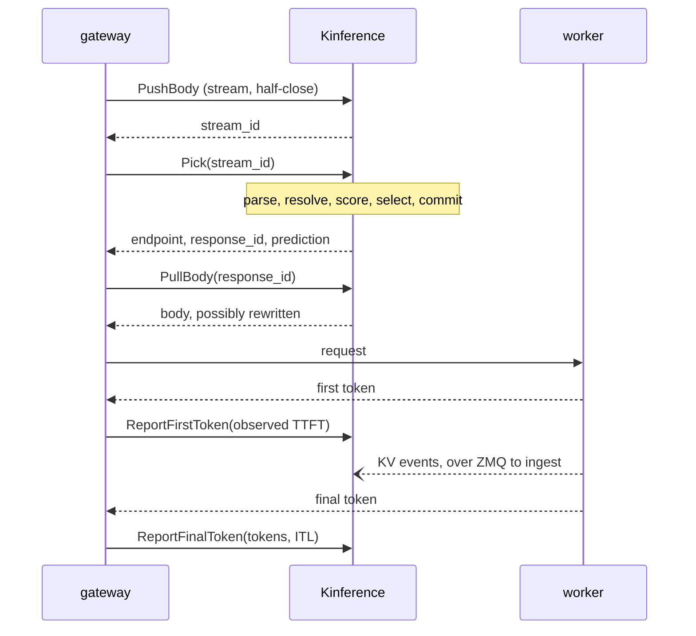

# Request flow

How Kinference runs, in order: the boot sequence, one pick from the pushed
body to the reported tokens, and the loops underneath that keep the fleet
and the policy current. [ARCHITECTURE.md](../ARCHITECTURE.md) says what
each module owns; this page says only when each module runs.

## Boot

`server::run` does the following, in this order.

1. Start logging. `RUST_LOG`, `KINFERENCE_LOG_FORMAT` and `NO_COLOR`
   configure the subscriber.
2. Load and validate the config from the path on the command line. Apart
   from the logging variables, this step is the only read of the
   environment.
3. Bind the gRPC listener, so that a port clash fails before anything else
   starts.
4. Create the one Prometheus registry. Every subsystem below registers its
   families in it.
5. Create the policy store, if policy is enabled, and the store of
   provider health. The policy store starts empty, and `/readyz` reports
   not ready until the control plane has filled it.
6. Build the discovery factory from the controller crate. Through the
   factory, the fleet gets Kubernetes discovery without holding a client.
7. Call `Fleet::new`, which builds the pool registry, the model index, the
   scrape registry, the coordinator and the pool manager. Nothing runs
   yet; the handles exist so that the server can build the router against
   them.
8. Call `KinferenceService::start`, which builds the tokenizer, the scoring
   reads over the fleet handles, the body store and the observations. It
   also spawns the two sweeps that expire bodies and observations past
   their TTL.
9. Call `Fleet::start`, which materializes the worker sets that the config
   declares and runs the coordinator loop. From here on, the coordinator
   can add workers.
10. Call `controller::start`. It connects to the API server and runs the
    worker-set watch (or, with Kubernetes off, only the reap sweep), then
    the CRD watch, the elector, and the status and binding writers. It
    returns a handle, and the server awaits the handle's `shutdown` at the
    end.
11. Call `admin::spawn`, if the config sets an admin address. The admin
    listener serves `/readyz`, `/metrics` and the read-only policy API.
12. Log that kinference is ready and serve the `Picker` service until
    SIGTERM or SIGINT arrives.

Shutdown runs in reverse. The signal stops the gRPC server from accepting
requests. The server cancels the token that it gave every task. Then
`Controller::shutdown` waits a bounded moment for the elector to vacate
its Lease, so that a peer can take over without waiting for the Lease to
expire.

## One pick

The proto header gives the wire sequence: `PushBody`, `Pick`, `PullBody`,
`ReportFirstToken`, `ReportFinalToken`, and `Abort` if the request dies
after the pick. All of this code is in `kinference-router`.

### PushBody

The caller streams the body in. `grpc::push_body` charges each chunk
against a `body_store::Reservation`, which enforces the byte budgets for
each request and for the whole server, and the idle budget between
chunks. On a clean half-close, `push_body` commits the reservation, stores
the body under a new `stream_id` and returns that id. If the caller resets
the stream, `push_body` discards the bytes.

### Pick

`grpc::pick` takes the `stream_id` out of the body store with
`begin_pick`, so a second `Pick` on the same id fails. Then it calls
`service::lifecycle::pick_and_record`, which runs five steps. Each step is
a method whose typed result the next step consumes.

1. Parse. The service parses the body into a JSON tree and keeps it as a
   tree, so that unknown fields survive the later rewrite. The body must
   have a `model` field; it needs nothing else.
2. Resolve the model. `auto` and declared aliases become a concrete model,
   and the model index says which pools serve that model. A provider in
   the named `InferencePool` may serve a model that no local pool serves,
   so the service checks for one before it refuses the request. The
   pick-time rewrites in `pick_body` happen here. They set the resolved
   model, and for a streaming request they set
   `stream_options.include_usage`, so that the final usage block exists
   for the caller to report later. The service takes the chat-template
   inputs from the serialized body.
3. Score the groups. For the first pool that serves the model,
   `service::scoring::score_workers` takes the ready workers and tokenizes
   the prompt through the pool's tokenize mode: in process, through vLLM's
   `/render`, or both, compared. Then, for each block size in the pool, it
   hashes the tokens into blocks and matches the blocks against the pool's
   radix tree, which gives the cached-prefix overlap for each worker. The
   last scrape sample gives each worker's load. If tokenizing fails
   everywhere, scoring falls back to load alone rather than failing the
   pick. The service scores any further pools that serve the model with
   the same tokens.
4. Select. With no `InferencePool` named, or with policy disabled,
   `best_group` ranks the scored pools, and the winner's group goes on to
   the commit. With a pool named, `service::policy_driver::policy_select`
   runs the compiled `InferencePolicy` over a snapshot of pools, worker
   sets and providers. It flattens the candidates per endpoint, applies
   the exclusions, and ranks the rest. Ranking holds no pool lock, because
   candidates may span pools, so the ranking's input may miss one
   concurrent pick. The winner is either a local group or a provider. If
   the policy chose a model other than the one that the body names, the
   service rewrites the body again.
5. Commit. This step runs under the winning pool's `pick_lock`, the only
   critical section on the request path. The picker in `picker` takes each
   worker's scores, in-flight count and dispatched prefixes, computes the
   layered overlap and the predicted wait for each worker, and chooses the
   endpoint. Then the service does the bookkeeping:
   - It raises the in-flight count for that endpoint.
   - It records the prompt's prefix as dispatched, so that the next pick
     credits this worker before the engine's events land.
   - It stashes a `PendingObservation` with the prediction under the new
     `response_id`.
   - It increments the routed counter.

   When a provider wins, the service skips the lock and the fleet
   bookkeeping and records a provider pick instead.

Back in `grpc::pick`, the service commits the rewritten body to the body
store under the `response_id`. The response holds the endpoint, the
prediction and the id.

### PullBody

`grpc::pull_body` takes the outbound body for the `response_id` as a lease
and streams it out. The caller forwards that body upstream in place of the
body that it sent.

### ReportFirstToken

The caller reports the observed time to first token.
`grpc::report_first_token` calls `Observations::finalize`, which takes the
pending observation back, releases the in-flight count that the
observation held, and logs an event of predicted versus observed latency
under the `kinference::observation` target. A provider pick has no pending observation, so for a
provider the report feeds provider health instead. An upstream status of
zero in the report means that no response reached the caller. The service
then treats the request as never dispatched, and releases it through
`abort_request` rather than finalizing it.

### ReportFinalToken

After the response completes, the caller reports the served model, the
token counts and the histogram of inter-token latency.
`grpc::report_final_token` records them as request-path metrics and, for a
provider, as feedback on that provider.

### Abort

If the request will never dispatch, `abort_request` releases the body, the
pending observation and its in-flight state, and logs no observation
event. The
service counts the reason and, for a provider, folds it into provider
health.

### Backstops

A caller that never reports leaves state behind. The observation sweep
expires pending observations past their TTL and releases their in-flight
state; the body sweep reclaims buffered bodies past their TTL.
`KinferenceService::start` runs both sweeps on a fixed interval.

## The loops underneath

### Workers arriving and leaving

Each pool's discovery task is the source of truth for which workers exist.
In Kubernetes that task is `controller::discovery::KubeDiscovery`. It
watches the EndpointSlices of the worker set's Service, derives the set of
Ready endpoints on every event, and diffs that set against the endpoints
that it has already announced. A worker's identity is a hash of the pod's
UID, so a restarted pod is a new worker, and Kinference sees its cache as
empty.

Each `WorkerChange` lands in the coordinator's inbox. On `Added`,
`fleet::coordinator` registers the worker in the pool's registry and in
the fleet-wide indexes. Then it spawns the worker's two tasks, under a
cancellation token for that worker: the ZMQ ingest listener in `ingest`,
and the metrics poller in `scrape`. The poller fetches `/v1/models` once
right away, to learn the worker's models and engine. On `Removed`, or on
an eviction request, the coordinator cancels those tasks and drops the
worker from every store, but only if the pool that asks is the one that
registered the worker.

The worker's own tasks send eviction requests. The ingest task sends one
when it sees events at a block size other than the pool's, and the poller
sends one when the worker's `/v1/models` list disagrees with the pool's
canonical set. The task sends the request over the eviction channel, and
the coordinator does the teardown, so the lifecycle logic stays in one
place.

### KV events

For each worker, the ingest task holds a SUB socket for live events and a
DEALER socket for replay. The task applies each frame's events to the
pool's radix tree and to the tracker of in-flight prefixes. The tracker
retires a dispatched prefix block by block, as the engine's stored events
land. A gap in the sequence numbers makes the task request a replay; it
applies the replayed events in order, and then the live frame.

### Metrics

For each worker, the poller fetches `/metrics` on the configured interval
and `/v1/models` less often, and records the sample in the scrape registry
that scoring reads. The worker registry takes the models that each worker
reports, and the pool's claim on those models goes into the model index.
That claim is what makes a model routable.

### The control plane

`controller::start` runs these tasks, all through `api::ApiServer`.

- The worker-set watch. Every `InferenceWorkerSet` event wakes it up. It
  re-derives the desired pools from the whole store and hands them to the
  pool manager's `reconcile`, which creates, updates and retires pools.
  When a set names an unknown profile or an invalid block size, the watch
  rejects that set alone, reports the rejection on the set's status, and
  goes on with the rest. Reconciling waits until the initial list
  completes, because a partial store would retire every pool and discard
  its prefix cache. The reap sweep runs regardless.
- The policy watch. Reflectors on `InferencePool`, `InferencePolicy`,
  `InferenceWorkerSet`, `InferenceProvider`, `HTTPRoute` and
  `ReferenceGrant` feed `kinference_policy::resolve`, a pure function over
  their contents. The watch publishes the result into the policy store
  that the pick path reads, but only after every kind has listed once. A
  seventh reflector, on `Service`, gives the snapshot port numbers but
  doesn't hold up publishing.
- The elector. Each deployment has one Lease. The holder renews it inside
  a grace window, a rival waits for it to expire, and a clean shutdown
  vacates it. The elector reports leadership on a boolean watch channel.
  With election disabled, the channel is simply true.
- The status writer. It computes status for the policy resources from the
  snapshot and the live state of the pools. It patches only what differs
  from its last write; otherwise its own watch would wake it forever. A
  conforming gateway programs no route until the pool reports
  `Accepted=True`, so nothing routes until the status writer has run
  once.
- The binding writer. It writes one `BackendBinding` for each
  `InferencePool`, with the pool's name and in the pool's namespace. The
  binding translates the pool's destinations into kinds that the gateway
  can resolve.

Leadership gates only the two writers. The watches and the elector run on
every replica, and routing never waits on any of them.
