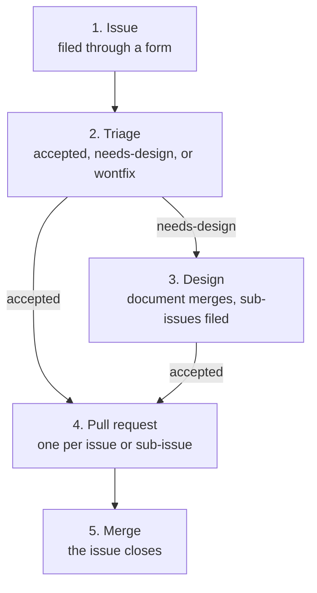

# Contribution workflow

Every change to Kinference starts as an issue, waits for a maintainer
to accept the issue, and only then lands as one or more pull requests
that close it. A maintainer inserts a design step for some changes.

- Without a design step: one pull request with one or more commits.
  Bug fixes, typos and small refactorings go this way.
- With a design step: a design document that the maintainers approve
  on its own, then one or more pull requests that each ship on their
  own. A plugin system, a complex performance optimisation, a major
  refactor, a large piece of new functionality or a change to a
  contract that the gateway or a CRD depends on goes this way.

## 1. Issue

The contributor files a bug report or a feature request through the
issue forms. The forms are the only way to open an issue, and each
one asks for what a maintainer needs in order to decide.

## 2. Triage

A maintainer applies `accepted`, applies `needs-design`, or closes
the issue with `wontfix`. The Labels section says what calls for
`needs-design`. An issue with `needs-design` is a proposal. The
maintainers decide here whether they want the change at all, before
anyone spends time on a document. A proposal earns `accepted` when
its design merges.

## 3. Design

The proposal issue is the parent of the whole change. The proposal
stays open from this step to the last merge. The design references
the proposal, and the sub-issues hang under it. The proposal's
timeline is the record of the change.

The contributor writes a design document from
[design/TEMPLATE.md](../design/TEMPLATE.md) as
`design/<YYYY-MM-DD>-<slug>.md`. The front matter names the proposal
issue and starts with `status: draft`. The Break-down section lists the
pull requests in the order that they land, each one leaving `main`
shippable.

The design is a pull request. Its Issues part says `Part of #N` with
the proposal's number, and the pull request does not close the
proposal. The maintainers review the design in that pull request. The
last commit before the merge sets `status: accepted`. A maintainer
merges, and replaces `needs-design` on the proposal with `accepted`.

After the design merges, the contributor files one feature request per
line of the Break-down section. Each one is a sub-issue of the
proposal. Its body says `Part of #N` and names the design file, and
its Done section comes from the design. The parent's `accepted` label
covers every sub-issue, so no sub-issue needs a label of its own. A
maintainer who wants to hold one piece back says so in a comment on
that sub-issue, and nobody claims the sub-issue until the maintainer
lifts the hold.

## 4. Pull request

The contributor claims the issue, branches, and opens a pull request
whose Issues part says `Closes #N`. After a design, the contributor
claims a sub-issue and opens a pull request for it, in the design's
landing order. Each pull request closes its sub-issue.

The maintainers review. The contributor answers review with fixup
commits, and folds them once the review is done.

## 5. Merge

A maintainer merges. The merge closes the issue. After a design, the
last pull request also sets the design's `status: implemented`, and
its Issues part says `Closes #N` for the proposal as well as for its
own sub-issue. That merge closes the parent.

## Rules

- Every pull request closes an issue that carries the `accepted`
  label, or a sub-issue of such an issue. A design pull request
  references the proposal issue instead of closing it. A pull request
  whose issue lacks `accepted`, or that names no issue at all, gets
  closed.
- A maintainer accepts an issue by applying the `accepted` label.
- A maintainer declines an issue by closing it with the `wontfix` label.
- A contributor claims an accepted issue by asking for it in a comment.
  A maintainer assigns the issue to the contributor. The assignee is
  the claim, and nobody opens a pull request for an issue that someone
  else holds.
- Commits, branch history, the sign-off and the shape of a pull request
  description follow [CONTRIBUTING.md](../CONTRIBUTING.md).

## Enforcement

The `Pull request policy` check runs on every pull request. The check
reads the linked issue's labels and assignee. A pull request that
names no issue, whose issue carries neither `accepted` nor
`needs-design`, or whose issue is assigned to someone else gets one
comment that names the rule. When
the repository variable `POLICY_ENFORCE` is `true`, the check also
closes that pull request. A description or a commit that strays from
CONTRIBUTING.md only fails the check. An edit, a push, or a label or
an assignment on the issue runs the check again. A pull request that
the check closed opens again once the pull request passes.

## Labels

- `accepted`: a maintainer greenlit an implementation. A proposal
  earns the label when its design merges, and the label then covers
  every sub-issue of the proposal.
- `needs-design`: the next step for the issue is a design document,
  not code. Only a maintainer applies the label, at triage or during
  review of a pull request, when any one of these holds:
  - The change needs more than one pull request to land with `main`
    shippable between them.
  - The change alters a contract that something outside this
    repository depends on: the picker protocol that the gateway calls,
    the `BackendBinding` that the controller writes, or the schema of
    a CRD. A new chart value or config field does not count on its
    own.
  - The change touches an invariant in
    [ARCHITECTURE.md](../ARCHITECTURE.md): the import direction, who
    talks to the API server, who writes, the purity of the picker and
    of `resolve`, or the locking rules.
  - The maintainer wants the choice between alternatives recorded.

  A maintainer who applies `needs-design` during review removes
  `accepted` from the issue, and the pull request waits for the design.
  When the design merges, a maintainer replaces `needs-design` with
  `accepted`.
- `wontfix`: a maintainer declined the issue.
